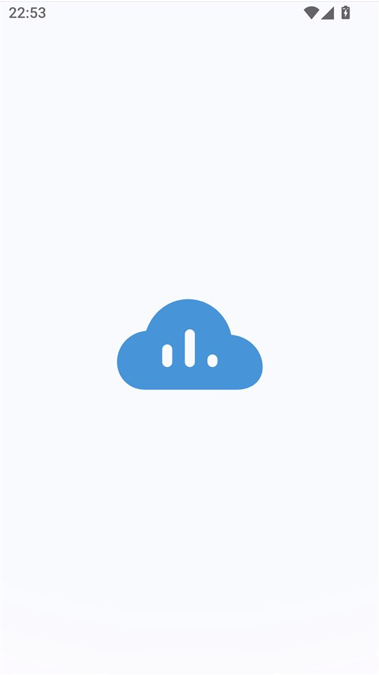
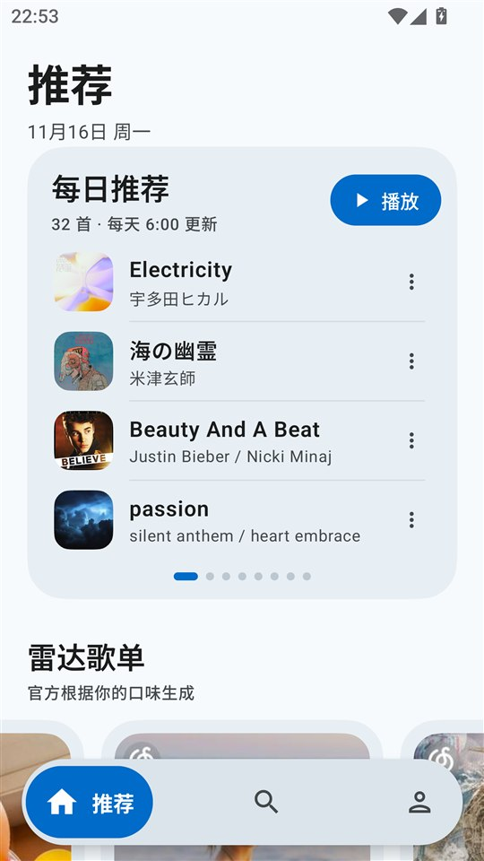
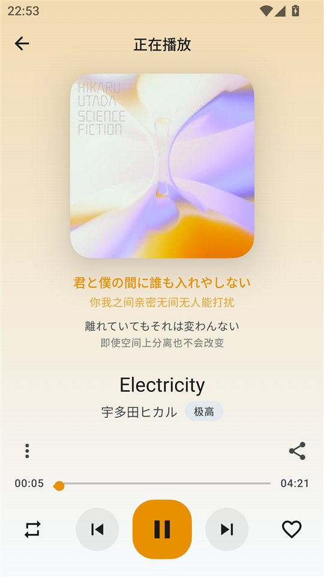
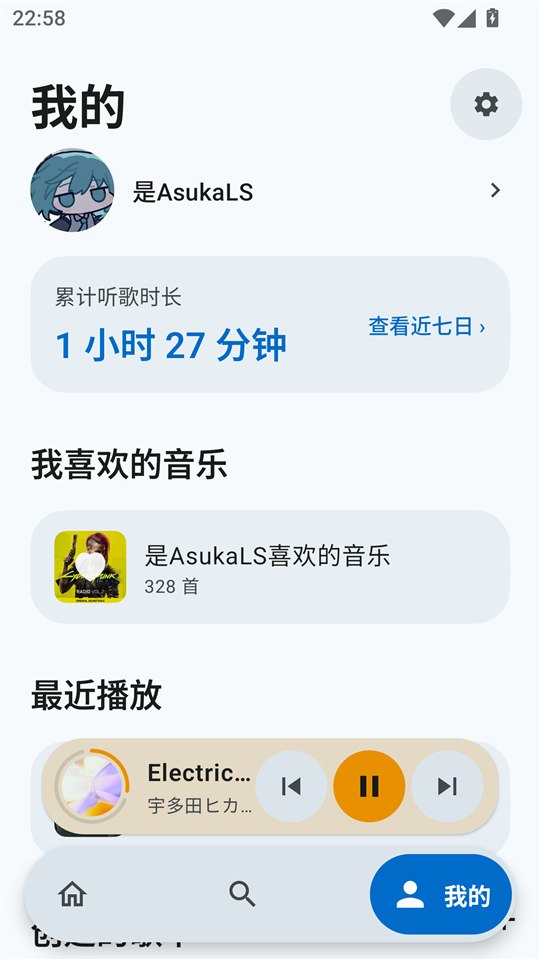
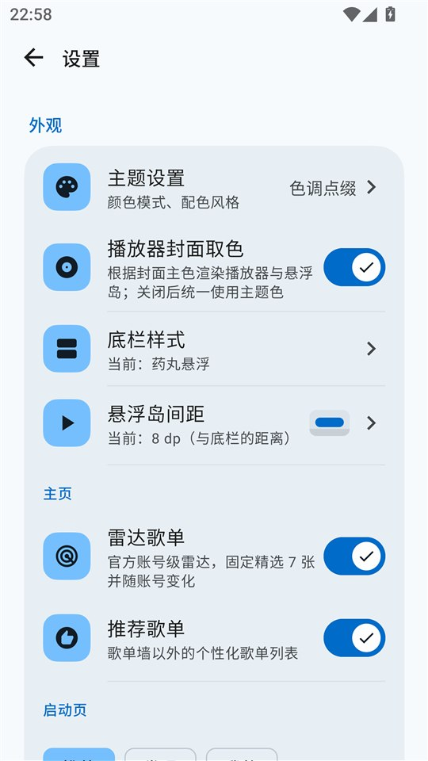

<div align="center">

# 云音 NCMusic

**网易云音乐第三方 Android 客户端**

Jetpack Compose · Material 3 · Media3 ExoPlayer

[](#构建)
[](#技术栈)
[](#技术栈)
[](LICENSE)

</div>

---

## 截图

| 启动 | 推荐 | 播放器 |
| :---: | :---: | :---: |
|  |  |  |

| 歌词 | 我的 | 设置 |
| :---: | :---: | :---: |
|  |  |  |

---

## 功能

**登录** — 扫码 · 手机号密码/验证码 · Cookie 粘贴

**播放** — ExoPlayer 后台播放与通知栏控制 · 六档音质（标准 → 超清母带）· 顺序/列表/单曲/随机 · 播放队列 · 定时关闭 · 本地音乐

**歌词** — 全屏滚动（逐行高亮 + 翻译）· 桌面悬浮歌词（可拖动 / 调色 / 锁定）· 进入即定位当前行，手动滑动后暂停跟随、4 秒自动恢复

**音效** — 10 段可视化均衡器 · 响度增强 · USB 独占输出 · 硬解/软解切换

**界面** — 莫奈动态取色 · AMOLED 纯黑 · 药丸悬浮底栏 · 悬浮岛（与底栏间距 0–40dp 可调）· 播放器封面取色 · 云朵揭幕启动动画

**其它** — 歌曲下载 · 收藏到歌单 · 分享 · 缓存上限与清理 · 听歌统计

---

## 构建

需要 JDK 17 与 Android SDK（compileSdk 36）。

```bash
./gradlew assembleRelease
```

签名信息放在 `keystore.properties`（不入库）：

```properties
storeFile=你的.jks
storePassword=***
keyAlias=***
keyPassword=***
```

Windows 下建议加 `--no-build-cache`，规避构建缓存锁。

## 技术栈

| 层 | 选型 |
| :--- | :--- |
| UI | Jetpack Compose + Material 3 |
| 播放 | Media3 ExoPlayer · 自建 DirectApi（eapi / weapi） |
| 数据 | DataStore · 本地缓存 · Coil |
| 架构 | 单 Activity + Compose Navigation + 常驻 Pager |

## 致谢

- 启动动画机制参考 [FluxDown](https://github.com/zerx-lab/FluxDown)（Apache-2.0）的 `LaunchReveal`
- 界面语言参考 SukiSU-Ultra 与 Material 3

## 免责声明

本项目仅供学习与个人使用，所有音乐内容版权归网易云音乐及版权方所有。请勿用于商业用途，因使用本软件产生的任何后果由使用者自行承担。项目使用非公开接口，存在稳定性风险；如权利人认为侵权，请通过 Issue 联系，将立即配合处理。

## 开源许可

[GPL-3.0](LICENSE) © 2026 Canelé (3399185897)

<div align="center">

**⭐ 如果这个项目对你有帮助，欢迎点个 Star**

</div>
